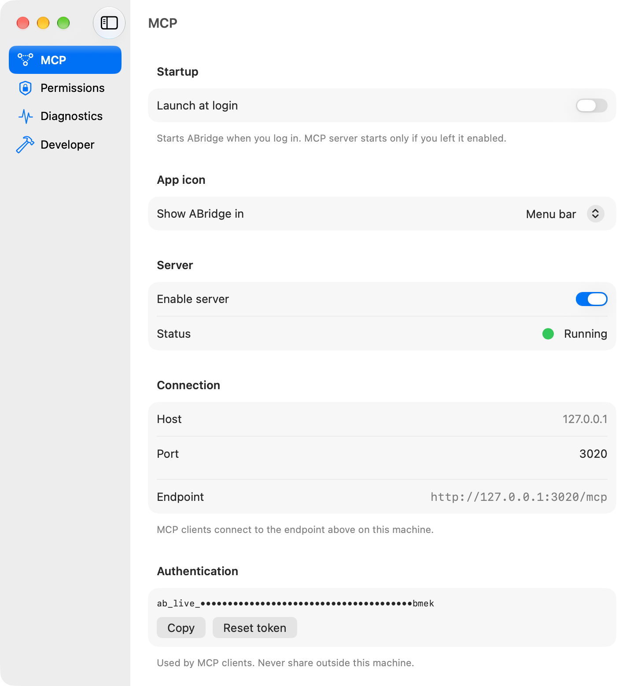
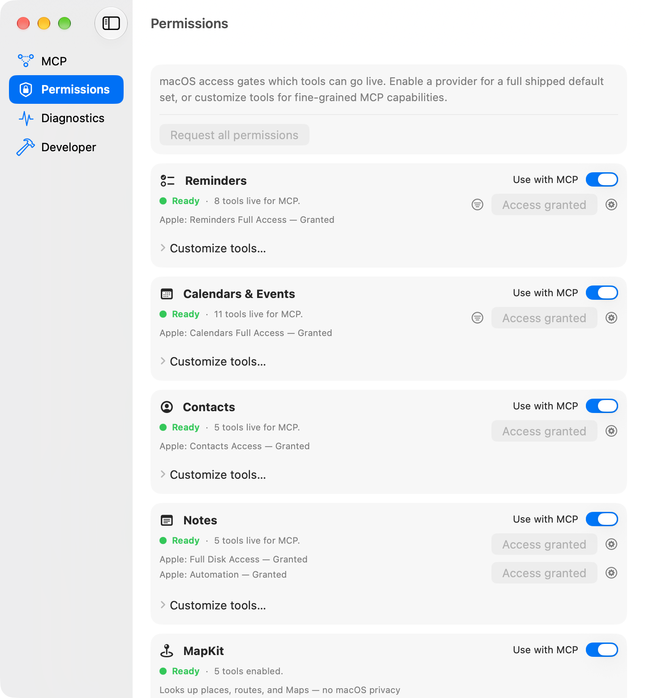
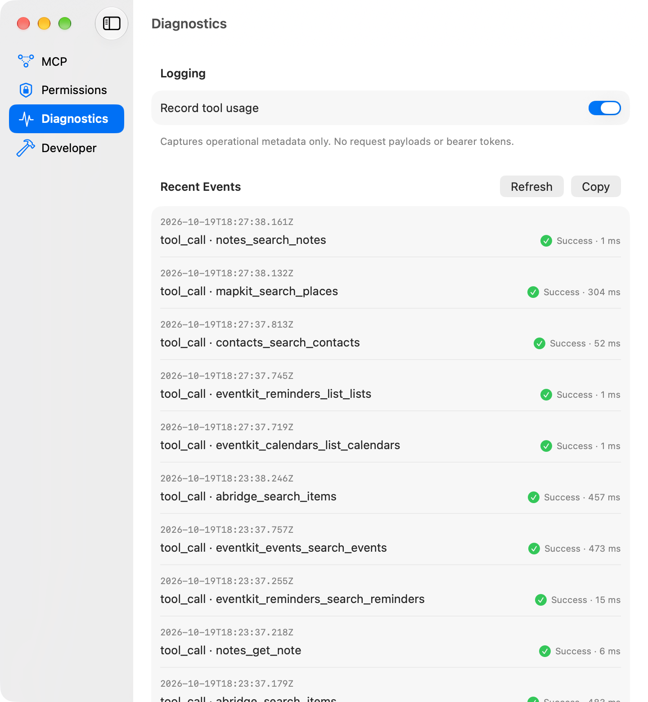

<br/>
<p align="center">
  <picture>
    <source media="(prefers-color-scheme: dark)" srcset="icon/mark-dark.png">
    </img>
  </picture>
</p>

# ABridge

**Apple frameworks on your Mac, one local MCP endpoint.**

A native macOS menu bar app with a Rust MCP/HTTP core. Swift owns the UI, system permission prompts, and thin Apple adapters. Rust owns the server, auth, routing, and tool registry (UniFFI). Clients talk to `127.0.0.1` only.

Providers: EventKit (Reminders, Calendars, Events), Contacts, MapKit, Core Location, Vision, and Notes. MCP responses carry what agents read, link, and act on: compact summaries, useful details, Markdown rich text, and files as separate content items. Framework/store internals, sync bookkeeping, and empty values stay out of the payload.

Access is two layers: macOS privacy permission, then per-capability MCP toggles in Settings. Only enabled capabilities appear in `tools/list`. Reminders lists and event calendars default to sharing all of them; Permissions can restrict MCP to a subset.

<p align="center">
  <picture><source media="(prefers-color-scheme: dark)" srcset="docs/screenshots/settings-mcp-dark.png"></picture>
  <picture><source media="(prefers-color-scheme: dark)" srcset="docs/screenshots/settings-permissions-dark.png"></picture>
  <picture><source media="(prefers-color-scheme: dark)" srcset="docs/screenshots/settings-diagnostics-dark.png"></picture>
</p>

### Connect your MCP client

| | |
|---|---|
| **Endpoint** | `http://127.0.0.1:3020/mcp` (default; configurable in the app) |
| **Auth** | Bearer token (copy from the menu bar app) |
| **Prerequisite** | ABridge must be running before your client connects |

Binds to loopback. Apple frameworks remain the system of record.

## Install

Requires macOS 26+ on Apple silicon.

```sh
brew install --cask rcanoff/tap/abridge
```

Or download `ABridge-<version>.dmg` from [Releases](https://github.com/rcanoff/abridge/releases) and drag ABridge to Applications. Builds are Developer ID signed and notarized.

ABridge updates itself through Sparkle: **Check for Updates…** in the menu bar, plus scheduled checks once you allow them.

## Build from source

```sh
git clone git@github.com:rcanoff/abridge.git
cd abridge
xcodegen generate
just build-rust
open ABridge.xcodeproj
```

Build and run the app, start the server from the menu bar, then point your MCP client at the endpoint above.

Builds are ad-hoc signed by default, so every rebuild has a new signature and macOS asks again for Keychain access to the API key and for privacy permissions. To sign local builds with your development certificate instead, create `Configs/Local.xcconfig` (gitignored) with your team:

```
DEVELOPMENT_TEAM = <your team ID>
CODE_SIGN_STYLE = Manual
CODE_SIGN_IDENTITY = Apple Development
```

Choose **Always Allow** at the next Keychain prompt; later rebuilds keep that grant.

## Prerequisites

macOS 26+, Xcode 26+, Rust 1.89+, [just](https://github.com/casey/just), [xcodegen](https://github.com/yonaskolb/XcodeGen), SwiftFormat, SwiftLint (`brew install swiftformat swiftlint`).

Icon tracing (`just gen-icon-svg`) also needs ImageMagick and potrace.

## MCP tools

Tool names are `<provider>_<domain>_<operation>`, or `<provider>_<operation>` when the provider has no domain, using only lowercase letters, digits, and underscores. Discover the live set with `tools/list`; call with `tools/call`.
A tool that searches more than one framework is `abridge_<operation>` (`abridge_search_items`). It is listed when any of the stores it searches is enabled.

### Responses and search

List/search tools return summaries for choosing an item; get/write tools return its detail shape. Absent keys mean null, false, or empty. Diagnostics keeps `success` and `logging_enabled` even when false. Files and contact photos follow the JSON as MCP content items, not base64 inside the JSON; list/search results contain no photo bytes. Event, reminder, contact, and group lists default to 50 items (maximum 200); `offset` pages them. Event start and end, including each occurrence, are local wall time with a numeric offset in the event time zone, or the server Mac's time zone when the event has none (not the caller's), plus `time_zone` when known. All-day events return `start_date` and `end_date` as calendar dates `YYYY-MM-DD`. `end_date` is exclusive (the day after the last day). Each calendar day is that serialized instant converted into the event's time zone, or this Mac's time zone when the event has none. Pass an absolute time such as `2026-10-26T09:00:00-04:00`, or wall time `2026-10-26T09:00:00` with `time_zone` `America/New_York`. All-day events use `2026-10-26`. The server does not treat its clock or time zone as the caller's. Reminder due and start dates are `YYYY-MM-DD` when date-only. A time whose components include `time_zone` is local wall time with that zone's offset. A time with no components `time_zone` is floating wall time with no offset and `floating: true` (that clock time wherever the person is, not the server's zone). A due time written without a components `time_zone` stays floating. A title search for events with no dates covers 1 year before through 2 years after the server Mac's current time. `eventkit_reminders_delete_reminder` takes `calendar_item_identifier` or `reminder_title` (exact, case-insensitive); `calendar_identifier` limits a title to one list. Several matches return `reminder_title_ambiguous` and delete nothing. `eventkit_events_delete_event` takes `event_identifier` or `event_title` the same way, in that window unless `start_date` and `end_date` are set. Occurrences of one series count as one event. Several events return `event_title_ambiguous`. Pass a row's `start_date` as `occurrence_date` to get, update, or delete that occurrence. A recurring update or delete without it returns `occurrence_required` and changes nothing. `span` is `this_event` (default) or `future_events`. Recurrence `days_of_the_week[].day_of_the_week` is `sunday` through `saturday`. `week_number` stays an integer.

Notes and contacts/events/reminders `query` match inside words: space-separated terms must all match, a fuzzy term stays inside one word (letters or digits; a hyphen or apostrophe stays in the word), and matching is case-insensitive and accent-insensitive (`acao` matches `ação`). `"buy milk"` is one exact phrase (spaces stay). A leading `'exact` is a substring of one word and does not quote spaces. `^prefix` and `suffix$` anchor a word, `!negate` excludes a match, and `a | b` matches either. An unmatched `"` is ignored. Hits rank weighted fields best first and include `score` and `matches: [{field, excerpt}]`, with matched text marked by `«»`. Apple date, calendar, and completion filters still apply. MapKit uses its own query syntax; resolve a landmark with `mapkit_search_places` and a region bias (`region_priority` `required`), then pass that place's coordinate or identifier to `mapkit_estimate_travel_time`. `name` on a route endpoint is a label and does not geocode. Core Location and Vision have no fuzzy query. `corelocation_get_current_location` is this server Mac's location, not the caller's. It reports `location_services_off`, `permission_denied` (denied, restricted, or not determined), or `location_unknown` (no fix or timeout, including kCLErrorDomain error 0). Vision tools take exactly one of `image_data` (base64) or `image_path` (an absolute path of a regular file on this Mac, at most 20 MiB; a symlink is followed when the final target is a regular file). A PDF is accepted by its contents, not its file extension. `page` selects one page (default 1). A PDF result includes `page` and `page_count`. A page past the end is `page_out_of_range`. `page` greater than 1 on an image is `invalid_arguments`. An encrypted or unreadable PDF is an error.
`abridge_search_items` searches notes, reminders, and events with one `query`. It runs only the stores whose search capability is enabled. `stores` limits that set to `notes`, `reminders`, and/or `events`. With no event dates, the event range is the same window `eventkit_events_search_events` uses: 1 year before through 2 years after this server Mac's current time, not the caller's. `limit` defaults to 20 (maximum 100). `offset` skips that many merged hits (default 0). Each item has `store`, the identifier that store's get or delete tool takes (`note_identifier`, `calendar_item_identifier`, or `event_identifier`), `title`, the folder path or list title or calendar, `score`, and one `excerpt`. An event item's `start_date` is the `occurrence_date` to pass to get, update, and delete. It is local wall time with a numeric offset in the event's time zone, or this Mac's when the event has none, not the caller's. All-day `start_date` is `YYYY-MM-DD` and `is_all_day` is true. A store that fails or is denied is listed in `store_errors`; the other stores are still returned.

### EventKit: Reminders

- `eventkit_reminders_list_lists`
- `eventkit_reminders_create_list`
- `eventkit_reminders_delete_list`
- `eventkit_reminders_list_reminders`
- `eventkit_reminders_search_reminders`
- `eventkit_reminders_get_reminder`
- `eventkit_reminders_create_reminder`
- `eventkit_reminders_update_reminder`
- `eventkit_reminders_delete_reminder`
- `eventkit_reminders_move_reminder`
- `eventkit_reminders_complete_reminder`
- `eventkit_reminders_uncomplete_reminder`
- `eventkit_reminders_set_reminder_alarms`
- `eventkit_reminders_set_reminder_recurrence`

### EventKit: Calendars and Events

- `eventkit_calendars_list_calendars`
- `eventkit_calendars_create_calendar`
- `eventkit_calendars_update_calendar`
- `eventkit_calendars_delete_calendar`
- `eventkit_events_list_events`
- `eventkit_events_search_events`
- `eventkit_events_get_event`
- `eventkit_events_create_event`
- `eventkit_events_update_event`
- `eventkit_events_delete_event`
- `eventkit_events_move_event`
- `eventkit_events_set_event_alarms`
- `eventkit_events_set_event_recurrence`

`eventkit_events_delete_event` and `eventkit_reminders_delete_reminder` also take an exact, case-insensitive title. Recurring event update and delete take `occurrence_date` and `span`. Recurrence weekdays are `sunday` through `saturday`.

`eventkit_events_delete_event` and `eventkit_reminders_delete_reminder` also take an exact, case-insensitive title. Recurring event update and delete take `occurrence_date` and `span`. Recurrence weekdays are `sunday` through `saturday`.

Invitation RSVP is not supported. The registry includes `eventkit_events_accept_invitation`, `eventkit_events_decline_invitation`, and `eventkit_events_tentative_invitation`, but their capability is unavailable in Settings.

### Contacts

- `contacts_list_contacts`
- `contacts_list_containers`
- `contacts_search_contacts`
- `contacts_get_contact`
- `contacts_create_contact`
- `contacts_update_contact`
- `contacts_delete_contact`
- `contacts_link_contacts`
- `contacts_unlink_contacts`
- `contacts_list_groups`
- `contacts_create_group`
- `contacts_update_group`
- `contacts_delete_group`

### MapKit

- `mapkit_search_places`
- `mapkit_search_nearby`
- `mapkit_reverse_geocode`
- `mapkit_forward_geocode`
- `mapkit_calculate_route`
- `mapkit_estimate_travel_time`
- `mapkit_open_navigation`
- `mapkit_get_place`

### Core Location

- `corelocation_get_current_location`

### Vision

- `vision_recognize_text`
- `vision_recognize_documents`
- `vision_detect_barcodes`
- `vision_detect_face_landmarks`

Each accepts an image or a PDF. `page` selects one PDF page (default 1). A PDF result includes `page` and `page_count`.

### Notes

- `notes_list_folders`
- `notes_list_notes`
- `notes_get_note`
- `notes_get_attachment`
- `notes_search_notes`
- `notes_create_note`
- `notes_update_note`
- `notes_move_note`
- `notes_delete_note`
- `notes_create_folder`
- `notes_delete_folder`

Apple Notes has no public framework, so this provider runs in Rust. Reads open `~/Library/Group Containers/group.com.apple.notes/NoteStore.sqlite` read-only in one transaction and decode compressed protobuf note bodies and tables. Reads need Full Disk Access for ABridge; writes also need Automation access to control Notes. Permissions shows both.

Start with `notes_list_folders`: each folder includes `account {identifier, name}`, a path, and a note count. Folders Notes has not downloaded from iCloud yet are left out. Pass that path as `folder_path` anywhere a tool takes `folder_identifier` (exactly one; add `account_identifier` when the path exists in more than one account). `notes_get_note`, `notes_update_note`, `notes_move_note`, and `notes_delete_note` take `note_title` (exact, case-insensitive) instead of `note_identifier`. A title matches live notes only, and notes in Recently Deleted only when the folder is that folder. On `notes_move_note`, `folder_path` and `folder_identifier` are the destination, and `note_title` finds the source. `notes_list_notes` returns summaries, pinned first and then most recently modified. `limit` defaults to 50 (maximum 200). Without a folder, lists and searches leave out Recently Deleted, notes without a folder, notes awaiting download, and notes marked for deletion. Specify a folder to include its notes, including Recently Deleted.

`notes_get_note` and note writes return details with a Markdown `body` and compact attachment metadata. Markdown preserves headings, checklists, numbered/bulleted lists, bold, italic, strikethrough, links, fenced code, and tables. Files and galleries appear as `[title](attachment:<id>)`; hashtags, mentions, and Math results appear as text. The attachment list is the files the body still references, plus gallery pages (`parent_identifier` links a page to its gallery). `attachment_count` counts that same set, and a gallery counts once. OCR is one copy. Tab-separated fragments are collapsed, then each line is keyed as lowercase letters and digits, and a later line is dropped when its key equals an earlier kept key, or is contained in one and the shorter key is at least 4 characters and at least 80% of the longer key's length. When a later key contains an earlier kept key under that same test, the later line replaces the earlier one in place. A line with no letters or digits is kept and is not a match. `summary` is included only when the attachment has neither OCR text nor `image_classification_summary`. `image_classification_summary` is omitted when its keyed text equals the OCR text. Note detail caps that text at 2,000 characters, with `ocr_truncated` when it was cut. Locked, unavailable, or empty bodies are omitted.

`notes_search_notes` uses the shared query syntax above across note text and attachment text. It returns summaries without the body or list snippet, plus `score` and up to 3 `matches` of `{field, excerpt}`. `excerpt` is the matched line or table row, capped at 120 characters, with the match inside `«»`. An attachment hit's `field` is `attachment: <id> <title>`. A match on attachment text also includes `attachment_identifier` and `attachment_title`. The default limit is 20 (maximum 100); `offset` skips hits. Its in-memory index is cached until the store or its write-ahead log changes.

Search or list returns note identifiers. `notes_get_note` returns the full body. When a search match names an attachment (`field` is `attachment: <id> <title>`), call `notes_get_attachment` directly. Search includes locally available document text and OCR Notes has already stored; excerpts show the matched line or table row, capped at 120 characters. Attachment-text matches name the identifier and title. File links appear once per attachment identifier. Inline tables are already in `body` and are omitted from `attachments` and `attachment_count`. Tables directly after a paragraph or list need no blank line. Updates warn if an existing table is replaced with text. Letter-spaced PDF extraction is repaired from its encoded text strings when their non-whitespace text agrees exactly.

Writes use fixed JXA through `osascript`, with input as JSON on the script's stdin (`osascript -e` holds the fixed script; the payload is not an argument), so Notes owns every change and iCloud sync. Writes are serialized. An update confirms `note_data` changed, not `modification_date` alone, then returns the detail object, or fails with `write_unconfirmed`. `write_unconfirmed`, and an osascript timeout, means the change may have happened; read the note before retrying. An identical body succeeds without waiting. Create and update bodies are Markdown, the same dialect `notes_get_note` returns. A leading `# Title` becomes the note title, which Notes takes from the first line. `#` and `##` are stored as bold 24pt and 18pt text with no paragraph style and read back as `#` and `##`. Headings beyond `##` read back as bold. A blank line between blocks becomes an empty line in the note, which is how Notes spaces sections; blocks without a blank line between them stay on adjacent lines. Notes may normalize links: a bare domain gains a trailing slash. Creating `- [ ]` / `- [x]` stores ordinary bullets, not a native checklist, so a later `notes_update_note` can replace that text. `notes_update_note` replaces the whole body. Block quotes become plain paragraphs. Fenced code round-trips; inline code reads back as plain text. Tables and a line of `---` round-trip. HTML in the body is converted. The returned note includes warnings naming every converted HTML tag and every removed HTML tag, and headings are stored as bold text and read back as `#` / `##` headings. `[title](attachment:<id>)` does not attach or keep a file. `notes_update_note` refuses with `body_would_drop_content` when the note is password protected or has a checklist or an attachment other than a table, and the error names each one. It refuses with `body_unavailable` when the current body is missing, not downloaded, past the inflate limit, or not a note protobuf, including a `note_identifier` that is still awaiting download. It refuses with `note_changed` when the live note's modification date is newer than the snapshot just read, or the live attachment count differs. Nothing is written, so read the note again and retry. Notes with files or checklists cannot have their text edited through scripting without losing them, and nothing was changed. Deleting moves a note to Recently Deleted and sets `deletion` to `recently_deleted`. It is not erased. `notes_move_note` restores it. Deleting a note already there is refused. `notes_delete_folder` deletes an empty folder and returns `{folder_identifier}`. The script rechecks the live folder immediately before deleting and returns `folder_not_empty` if it now holds notes or subfolders. It asks Notes to save, including when Notes has already dropped the folder from scripting (`-1728`), then polls until the row is gone or marked for deletion. If the row is still listed, the code is `folder_delete_unsaved`. It refuses a folder that still holds notes or subfolders, Recently Deleted, a smart folder, and the account's default folder. Folder names must differ from sibling names (exact, case-sensitive match); `folder_name_taken` identifies the existing folder.

`notes_get_attachment` defaults to Markdown in `content` and does not return a file. `format` is `markdown`, `image`, or `original`, and the JSON records which one was used. `source_path` is the absolute Media, FallbackPDF, or FallbackImage path when that file is on disk. `file_size` is the size of the file on disk when that file is present, and the size Notes stored otherwise. `notes_get_note` uses the same rule. The file's MIME type comes from its header (JPEG, PNG, GIF, WebP, HEIF/HEIC, PDF, TIFF, QuickTime/MP4), with the extension only as a fallback, and that type decides rendition and image versus resource content. Markdown and image do not copy it. Markdown `content` is paged with `max_characters` (default 15000, at most 100000) and `offset` (a Unicode-character offset, not a page or byte offset); a cut page sets `content_truncated` and `next_offset`. PDF, Word, PowerPoint, Excel, OpenDocument, RTF, EPUB, and CSV become GitHub-Flavored Markdown through `anydoc` (local, no network). A file larger than 50 MiB is not read: markdown returns `extraction_too_large` and no text, and search does not index that file. Unsupported formats are recognized from the UTI, extension, and a short header and are not read in full. A scanned or image-only PDF, and a Paper scan (`com.apple.paper.doc.scan`, `com.apple.paper.doc.pdf`), return the deduped OCR Notes has already stored, described above. That is not a fresh Vision pass; use `vision_recognize_text` with `image_path` when the stored text is absent. A photo or drawing uses that text plus image classification when it is not the same text, and says the picture is available with `format` `image`. A gallery lists its pages; a table is its Markdown. `format` `image` returns a viewable JPEG and omits OCR and summary text. A photo or drawing, or one page of a PDF or scan, is rendered with `sips` at long edges 2048, 1568, 1024, then 768. For a PDF or scan, `page` picks the page (default 1), and the JSON sets `page` and `page_count`; a page past the end returns `page_out_of_range`. The JSON sets `rendition` to `jpeg` or `jpeg_page`. That JPEG is exempt from the 20 MiB cap. `format` `original` copies the unmodified file to `$TMPDIR/abridge-attachments/<attachment identifier>/<file name>` (directory mode 0700, file mode 0600; entries older than 24 hours are removed on each call), sets `file_path` to that copy and `source_path` to the Notes path, and returns no file bytes. There is no size cap. Missing downloads, locked notes, encrypted documents, and attachments with nothing to read return typed errors. See [binary content and renditions](docs/conventions.md#binary-content-and-renditions).

### Diagnostics

- `diagnostics_get_usage_log`

### Not supported

LocalAuthentication, AVFoundation, CoreBluetooth, HealthKit, PhotoKit, UserNotifications, HomeKit, MusicKit, Shortcuts.

## Architecture

- **Swift:** UI, permissions, Keychain, thin Apple adapters
- **Rust:** MCP/HTTP server, auth, routing, provider registry, agent-facing shapes, fuzzy search, tests, and the Notes provider (store reader, Markdown rendering, JXA writes, attachment files)

See the [architecture guide](docs/architecture-bootstrap-guide.md) for bootstrap steps and endpoint design.

Settings tabs: MCP, Permissions, Diagnostics, Developer.

## Project map

| Path | Purpose |
|------|---------|
| `ABridge/` | SwiftUI app, stores, services, thin providers, app icon, menu-bar mark |
| `ABridgeTests/` | Swift Testing unit tests |
| `rust/abridge_core/` | MCP/HTTP server, auth, routing, Rust tests |
| `ABridgeCore/` | Generated by `just build-rust`. Not committed. Do not edit. |
| `icon/` | Mark source: preview, SVG, Icon Composer, README tiles |
| `project.yml` | XcodeGen source. Run `xcodegen generate` after edits |
| `justfile` | Task runner for dev and CI |
| `.githooks/` | Git hooks (verify and optional review chain) |
| `local/review/` | Local agent PR review (gitignored) |
| `docs/` | PRD, conventions, architecture guide |

## Development commands

| Command | Purpose |
|---------|---------|
| `just test-swift` | Swift unit tests |
| `just test-rust` | Rust tests |
| `just lint-rust` | Rust fmt + clippy |
| `just fmt-check-swift` | SwiftFormat lint |
| `just lint-swift` | SwiftLint |
| `just ci` | Full local CI parity (macOS) |
| `just ci-rust` | Rust CI subset |
| `just ci-macos` | macOS CI subset |
| `just review` | Local agent code review |
| `just gen-icon-svg` | Trace `icon/previews/mark.jpg` to SVG |
| `just gen-menubar-icons` | Rasterize the SVG into the menu-bar template |
| `just release-build <version>` | Signed, notarized DMG and Sparkle appcast in `build/release/` |

## CI

CI workflows are `workflow_dispatch` only. Run CI locally before pushing:

```sh
just preflight   # alias for `just ci`: Rust + macOS steps
```

| Command | What it runs |
|---------|----------------|
| `just ci` | Full local CI parity (`ci-rust` + `ci-macos-steps` on macOS) |
| `just ci-rust` | Rust fmt, clippy, tests (Linux or macOS) |
| `just ci-macos` | SwiftFormat, SwiftLint, UniFFI build, Swift tests (macOS only) |

Workflow definitions stay in `.github/workflows/`.

Not automated in CI: EventKit permission dialogs, interactive Keychain, E2E MCP sessions. See `docs/conventions.md`.

## Releasing

Push a `vX.Y.Z` tag from `main`. The [Release workflow](.github/workflows/release.yml) builds the Rust core, archives a Developer ID signed build with the hardened runtime, notarizes and staples the app and DMG, generates the Sparkle `appcast.xml`, publishes both to a GitHub release, and updates the cask in [rcanoff/homebrew-tap](https://github.com/rcanoff/homebrew-tap). The job runs in the `release` environment (Settings → Environments): its secrets, listed in the workflow header, reach only `v*` tag runs approved by a required reviewer.

```sh
git tag v1.0.0 && git push origin v1.0.0
```

- `CFBundleShortVersionString` comes from the tag; `CFBundleVersion` is the commit count of the tagged commit, so Sparkle sees every release as newer. MCP clients see the same version as `serverInfo.version`.
- Xcode and other local builds take the version from `git describe --tags` (for example `0.3.0-4-gabc1234-dirty`) via `scripts/stamp-build-version.sh`; with no reachable tag they keep the `0.0.0` placeholder from `project.yml`.
- The app reads its feed from `releases/latest/download/appcast.xml`, so the repository must be public for updates and Homebrew downloads to work.
- The Sparkle EdDSA private key signs every update; keep a backup outside CI. Losing it strands installed copies on their current version.
- Local build: `just release-build 1.0.0` (environment variables are documented at the top of `scripts/release.sh`); add `--skip-notarization` to check signing and packaging without submitting to Apple.

## Contributing

- Branch naming: `feat/...`, `chore/...` (see `AGENTS.md`)
- Before opening a PR: `just preflight`
- Install hooks: `git config core.hooksPath .githooks`
- Agent rules: `AGENTS.md`
- Deep reference: `docs/conventions.md`, `docs/architecture-bootstrap-guide.md`, `docs/prd.md`

## License

This repository is licensed under the [Apache License 2.0](LICENSE.md).

## Security

Report vulnerabilities privately. See [SECURITY.md](SECURITY.md).
